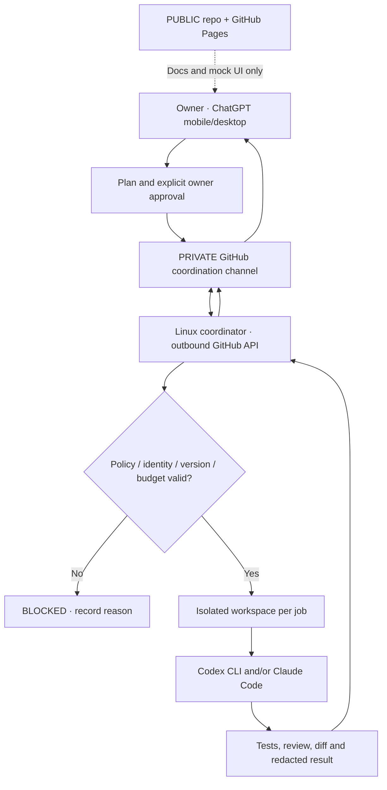

# Architecture and trust boundaries

**Status:** proposed logical design. No operational server or private control channel is deployed.

## Table of contents

1. [Three distinct environments](#three-distinct-environments)
2. [Communication flow](#communication-flow)
3. [Components](#components)
4. [Trust and isolation](#trust-and-isolation)
5. [Incremental decisions](#incremental-decisions)

## Three distinct environments

| Environment | Examples | Exposure |
| --- | --- | --- |
| Public project | `dev-coordinator-hub`: static Pages, docs, generic Issues/PRs | Anyone can read; **never** operational commands |
| Private coordination | **To be created**: authorised task records, approvals, redacted progress and outcomes | Only approved identities and worker |
| Local runtime | Linux host: service state, credentials, isolated worktrees, raw protected logs | No public API needed for MVP |

This distinction is a security boundary, not merely a directory convention. Public Pages is not an authenticated dashboard.

## Communication flow

This diagram describes a **future design**. Running an HTTP listener or publishing server credentials is not part of the first implementation.

## Components

| Component | Initial approach | Notes |
| --- | --- | --- |
| Private GitHub adapter | Outbound REST/polling with conditional requests where supported | Authentication, replay and rate limits must be tested |
| Task coordinator | Small Python service + durable state | Deterministic transitions rather than AI-controlled loops |
| State store | SQLite is an initial candidate | Verify concurrent access and backup/recovery requirements |
| Repository manager | Git clone/fetch/worktree | Approved repository allowlist; no destructive reset on checkout |
| CLI adapter | Official Codex / Claude Code CLIs | Authentication and terms are feasibility gates |
| Job sandbox | Non-root worker, file/network limitations | Per-run isolation; do not inherit coordinator credentials |
| Viewer | Static demo now; private Django later | No privileged browser actions on public Pages |

## Trust and isolation

The coordinator treats task bodies, Issue comments, repository contents, tests and model output as **data**, never automatic authority. A task must match an authorised actor, repository, approved specification hash, expiry and scoped permissions. Version changes revoke earlier approval until re-authorised.

Jobs are bounded by duration, attempts and allowed operations. The coordinator must be capable of aborting a job, denying a transition and recording the reason without calling an LLM. Reviewers default to read-only access to implementation output.

A repository can be selected on demand; it must not be installed or run until its identity and permissions are validated. No scripts from a newly cloned repository are auto-executed.

## Incremental decisions

- **Decided:** GitHub private bridge first; headless Linux and CLI workers; no root; VS Code optional.
- **Proposed:** Python service, SQLite, polling, worktrees, later Django.
- **Pending:** exact private repository design, server OS, agent access policy, isolation mechanism and retention model.

Design changes go through an Issue/PR and an update to [decisions](DECISIONS.md), not silent edits.
