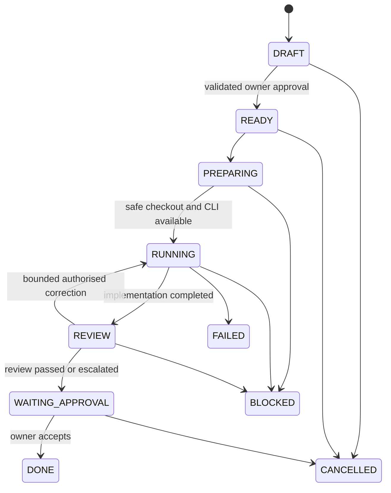

# Private task and agent hand-off protocol

**Status:** proposed protocol; **not implemented**, and never to be executed through this public repository.

## Table of contents

1. [Purpose](#purpose)
2. [Task record](#task-record)
3. [States and transitions](#states-and-transitions)
4. [Approval and trust](#approval-and-trust)
5. [Agent-to-agent hand-off](#agent-to-agent-hand-off)
6. [Failure and evidence](#failure-and-evidence)

## Purpose

Replace free-form, continuous model conversations with small structured, auditable events. ChatGPT helps the owner prepare a plan; the local coordinator determines when work may start, within the approved policy.

## Task record

The private control plane should eventually represent:

| Field | Purpose |
| --- | --- |
| `task_id`, `schema_version` | Stable ID and versioned parser |
| `repo_id`, `target_ref` | Allowlisted repository and immutable target |
| `intent`, `scope` | Requested outcome and explicit exclusions |
| `acceptance` | Verifiable tests/evidence required |
| `agent_policy` | Allowed CLI agents, role and review requirements |
| `model_policy` | Approved provider/model ID or bounded eligible tier; desired/effective effort, allowed fallback and data restrictions |
| `routing_rationale` | ChatGPT's explained recommendation, risk class and NO_AI/SINGLE/HANDOFF/PARALLEL/WAIT choice |
| `limits` | Maximum duration, attempts, context/session budget, concurrency |
| `requested_by`, `approved_by` | Auditable actor identities |
| `spec_hash`, `approval_expires_at` | Approval pinned to a specific task version |
| `status`, `revision` | Optimistic concurrency / lifecycle |
| `evidence_refs` | Commits, PR, checks and protected log references |

This is a design contract, **not** an executable YAML or a stable API schema yet.

## States and transitions

The transition map is indicative; cancellation, recovery and retry semantics must be tested. Every state change is persisted with the actor and timestamp. `FAILED` and `BLOCKED` are not auto-retry permissions.

## Approval and trust

- A text comment or label does not grant operating-system execution authority.
- Authorisation must come from an explicitly approved identity through a separately validated protocol.
- Approval binds repo, command scope, agent/model/effort or allowed tier, fallback constraints, limits, expiry and content hash. Material model-tier upgrades require reapproval.
- Any material mutation requires a new approval; repeated delivery with the same ID/revision is idempotent.
- The worker must refuse unexpected repos, dangerous commands, untrusted attachments and missing permits.
- Review and owner acceptance are distinct actions; no agent may grant itself additional permission.

## Agent-to-agent hand-off

Agents exchange compact evidence, not multi-thousand-token transcripts:

1. ChatGPT's proposed assignment is recorded with selected provider/model (if verified), desired effort, budget and whether independent review is warranted; owner approves permitted limits. See [collaboration policy](CHATGPT_AGENT_COLLABORATION.md) and [model selection](MODEL_SELECTION_POLICY.md).
2. Implementation agent returns summary, changed files, SHA/PR, tested outcomes and usage data only when actually available.
3. Coordinator records that output and checks deterministic requirements first.
4. Reviewer receives approved specification, relevant diff and tests, normally read-only.
5. Reviewer reports `APPROVE`, `REQUEST_CHANGES` or `BLOCKED` with actionable findings.
6. Coordinator can permit only a small preapproved number of correction loops before escalating.

No agent continuously polls another agent or expands the approved scope.

## Failure and evidence

Persist timeouts, cancellations, authentication failures, token-limit errors and audit events without copying secrets. Recover after crashes without duplicate execution. Usage percentages must be labelled **unverified** when providers do not expose accurate subscription telemetry. A failed CLI model lookup or unsupported effort setting must block or invoke only an explicitly approved equivalent fallback.

Result is not `DONE` simply because a CLI produced text. It must meet acceptance, have validation evidence and obtain the required human decision.
